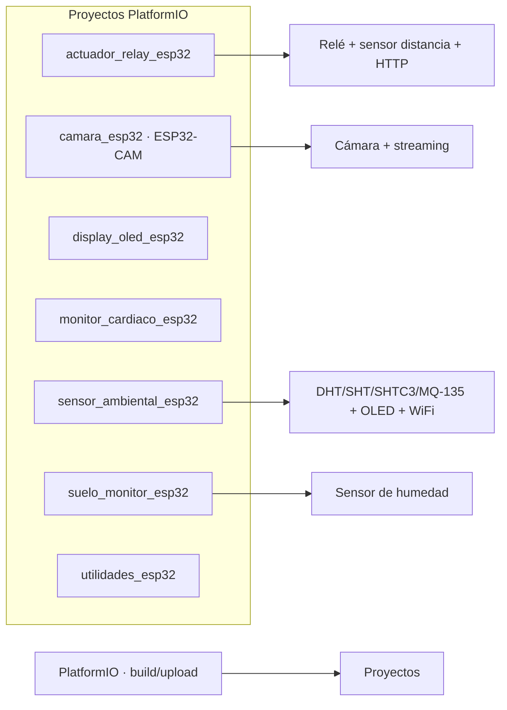

# esp32-examples

Colección de proyectos **ESP32** con PlatformIO, refactorizados desde sketches Arduino legacy. Cada proyecto es independiente, con su propio `platformio.ini` y configuración externa.

[](https://platformio.org)

## Contenido

- [Proyectos](#proyectos)
- [Arquitectura](#arquitectura)
- [Requisitos](#requisitos)
- [Uso](#uso)
- [Origen](#origen)
- [Licencia](#licencia)

## Proyectos

| Proyecto | Descripción | Sketches legacy |
|----------|-------------|-----------------|
| `sensor_ambiental_esp32/` | Sensor multi-tipo (DHT/SHT/SHTC3/MQ-135) con salida serial, HTTP y OLED | 10 unificados |
| `suelo_monitor_esp32/` | Monitor de humedad de suelo con backend configurable | 8 unificados |
| `display_oled_esp32/` | Gestor de displays OLED/TFT/LCD + efectos | 13 unificados |
| `actuador_relay_esp32/` | Control de relés con sensor de distancia y HTTP | 4 unificados |
| `camara_esp32/` | Servidor de streaming ESP32-CAM con detección | 2 unificados |
| `monitor_cardiaco_esp32/` | Monitor de frecuencia cardíaca (AD8232) | 2 unificados |
| `utilidades_esp32/` | Utilidades varias (termómetro web, IP pública, LCD) | 3 unificados |

Cada subproyecto incluye su propio `README.md` con detalles de hardware y configuración.

## Arquitectura



## Requisitos

- [PlatformIO](https://platformio.org/) (extensión de VS Code o CLI)
- ESP32 DevKit o compatible (ESP32-CAM para `camara_esp32`)
- Sensores según cada proyecto

## Uso

```bash
cd sensor_ambiental_esp32
pio run --target upload
pio run --target uploadfs   # para subir data/config.json
pio device monitor
```

Los proyectos con datos en `data/` (JSON de configuración) requieren el paso `uploadfs`.

## Origen

Estos proyectos reemplazan ~45 sketches Arduino IDE legacy del laboratorio, migrados a ESP32 con PlatformIO, configuración externa y código modular. Algunos sketches originales estaban rotos o con credenciales hardcodeadas; la refactorización los unifica y los hace configurables por archivo.

## Licencia

Sin archivo `LICENSE` declarado en el repositorio.